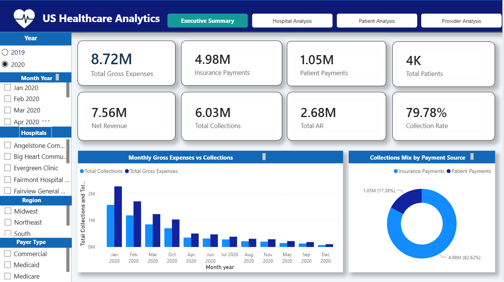
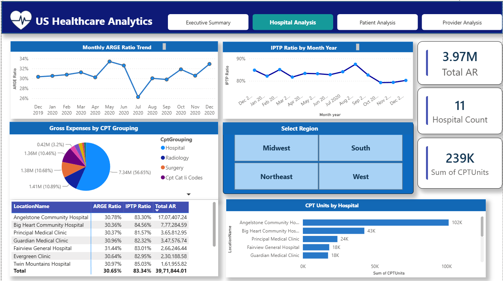
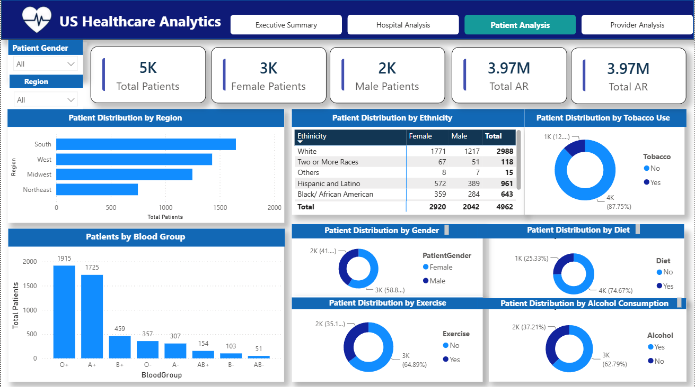
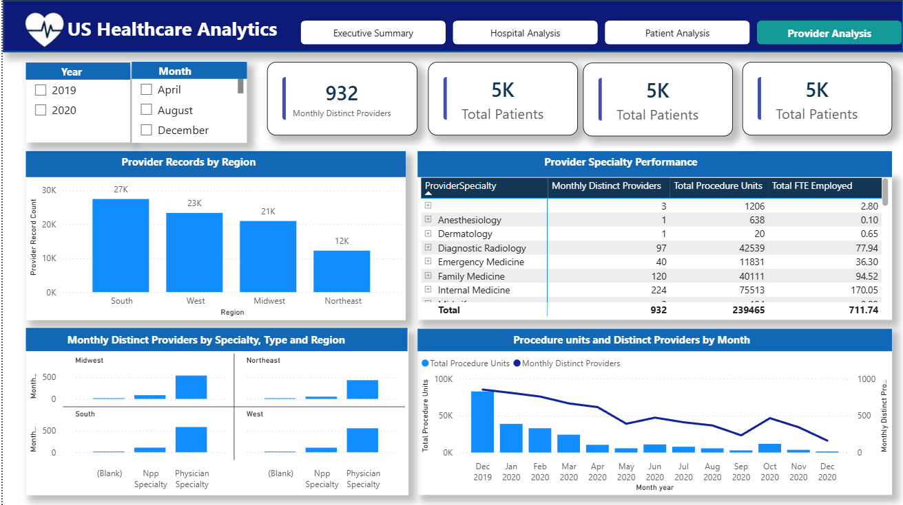

# US Healthcare Analytics | Power BI Dashboard

An interactive healthcare analytics project designed to analyse financial performance, hospital operations, patient demographics, and healthcare provider metrics across the US healthcare industry (2019–2020).

Built using Microsoft Power BI, Power Query, DAX, and data modelling, this project transforms healthcare data into meaningful insights through an interactive, four-page dashboard.

---

## Project Overview

Healthcare organisations generate large volumes of financial, operational, and patient-related data. Analysing these datasets independently can make it difficult to understand financial performance, hospital efficiency, and patient distribution.

This project brings these analytical dimensions together in a unified Power BI dashboard, enabling users to explore healthcare performance across multiple dimensions.

## Project Objectives

- Analyse healthcare expenses, revenue, and payment collections.
- Evaluate hospital financial and operational performance.
- Understand patient demographics and distribution patterns.
- Examine healthcare provider distribution, specialties, and workforce capacity.
- Develop interactive reports to support data-driven decision-making.

---

## Dashboard Modules

The dashboard consists of four analytical pages:

### 1. Executive Summary

Provides a consolidated overview of healthcare financial performance.

**Key Performance Indicators (KPIs):**
- Total Gross Expenses
- Insurance Payments
- Patient Payments
- Net Revenue
- Total Collections
- Total Accounts Receivable (AR)
- Collection Rate
- Total Patients

**Visualisations:**
- Monthly Gross Expenses vs Collections
- Collections Mix by Payment Source

### 2. Hospital Analysis

Evaluates hospital-level financial performance and operational metrics.

**Key Analytical Areas:**
- Accounts Receivable (AR)
- ARGE Ratio and IPTP Ratio
- Gross Expenses by CPT Grouping
- CPT Units by Hospital
- Hospital Performance Comparison

**Visualisations:**
- Monthly ARGE Ratio Trend
- Monthly IPTP Ratio Trend
- Gross Expenses by CPT Grouping
- Hospital Performance Matrix
- CPT Units by Hospital

### 3. Patient Analysis

Explores patient demographics, distribution, and lifestyle indicators.

**Key Analytical Areas:**
- Patient Distribution by Region
- Blood Group Distribution
- Ethnicity Analysis
- Gender Distribution
- Tobacco Usage
- Diet Patterns
- Exercise Patterns
- Alcohol Consumption

**Visualisations:**
- Patients by Region
- Patients by Blood Group
- Ethnicity Analysis Matrix
- Patient Distribution by Gender
- Patient Distribution by Tobacco Use, Diet, Exercise, and Alcohol Consumption

### 4. Provider Analysis

Examines healthcare provider distribution, specialties, and workforce metrics.

**Key Performance Indicators:**
- Monthly Distinct Providers
- Total FTE Employed
- Provider Specialty Count
- Provider City Count

**Visualisations:**
- Provider Records by Region
- Provider Specialty Performance Matrix
- Monthly Distinct Providers by Specialty Type and Region
- Total Procedure Units and Monthly Distinct Providers by Month

---

## Tools & Technologies

| Technology | Application |
|---|---|
| Microsoft Power BI | Dashboard development and reporting |
| Power Query | Data cleaning and transformation |
| DAX | KPI development and analytical calculations |
| Data Modelling | Fact and dimension tables, relationships |
| Power BI Visualisations | Interactive charts, matrices, and reports |

---

## Technical Implementation

### Data Preparation
- Data cleaning and transformation using Power Query.
- Data type corrections and consistency checks.
- Preparation of analytical tables.

### Data Modelling
- Fact and dimension table organisation.
- Relationship configuration.
- Filter propagation and model validation.

### DAX & Analytics
- Development of calculated measures and KPIs.
- Financial and operational performance calculations.
- Patient and provider aggregations.
- Ratio and percentage-based metrics.

### Dashboard Development
- Interactive slicers and filters.
- Cross-filtering between visuals.
- Multi-page report navigation.
- Consistent visual branding and formatting.

---

## Business Value

The dashboard enables users to:

- Monitor healthcare financial performance.
- Compare hospital-level operational metrics.
- Understand patient demographics and distribution.
- Evaluate provider workforce and specialty distribution.
- Explore monthly trends and regional performance.
- Support data-driven healthcare decision-making.

---

## Dashboard Preview

### Executive Summary



### Hospital Analysis



### Patient Analysis



### Provider Analysis



---

## Repository Structure

```text
US-Healthcare-Analytics/
│
├── README.md
│
├── PowerBI/
│   └── US_Healthcare_Analytics.pbix
│
├── Dashboard_Screenshots/
│   ├── Executive_Summary.png
│   ├── Hospital_Analysis.png
│   ├── Patient_Analysis.png
│   └── Provider_Analysis.png
│
├── Documentation/
│   ├── Data_Model.png
│   └── KPI_Definitions.md

```

---

## Key Skills Demonstrated

- Business Intelligence & Data Analytics
- Power BI Dashboard Development
- Data Cleaning & Transformation
- Data Modelling
- DAX & KPI Development
- Healthcare Financial Analytics
- Operational Performance Analysis
- Interactive Data Visualisation

---

## Author

**Rashmitha Pendyala**

Data Analyst | Business Intelligence | Power BI | SQL | Data Analytics

---

## Project Information

- **Project:** US Healthcare Analytics
- **Domain:** Healthcare Analytics
- **Period Covered:** 2019–2020
- **Primary Tool:** Microsoft Power BI

This project was developed as a portfolio project to demonstrate practical business intelligence, data modelling, and analytical reporting capabilities.

---

## Data Disclaimer

This project uses healthcare data for analytical and educational purposes. No personally identifiable patient information is intentionally shared.

